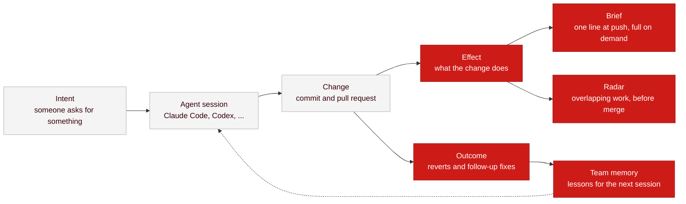
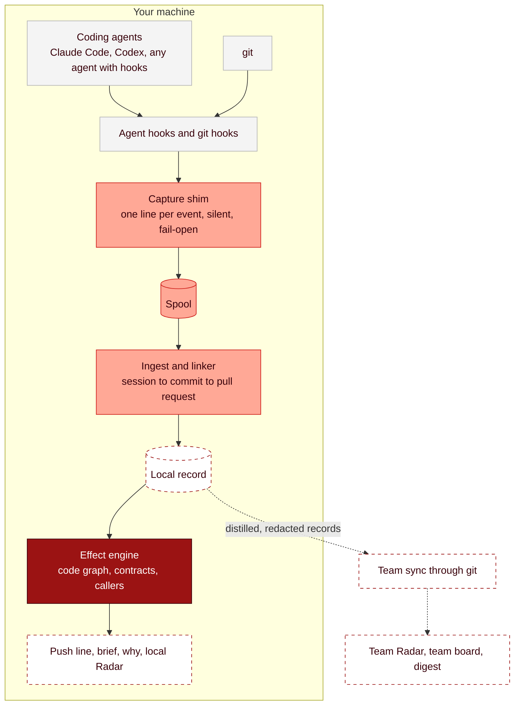

<div align="center">

# Orchestraty

**See what your coding agents changed, what it affects, and whose work it collides with, before you push.**

[](https://github.com/samratrajsharma/Orchestraty/actions/workflows/ci.yml)


[Overview](#overview) · [How it works](#how-it-works) · [Project status](#project-status) · [Repository layout](#repository-layout) · [Getting started](#getting-started) · [Development](#development) · [Privacy and security](#privacy-and-security)

</div>

---

## Overview

Coding agents now write a large share of the code in many teams. Writing code got cheap; knowing what was written did not. A reviewer sees a diff, not what the change does to the rest of the system. Two people's agents can change the same function on different branches, and nothing warns them until something breaks.

Orchestraty is the shared record and early-warning system for agent work:

- **It captures** sessions from any coding agent that exposes hooks, such as Claude Code and Codex, and links them to the commits and pull requests they produce.
- **It explains effects, not just diffs:** which contracts changed, whether a change is breaking, and which callers were never updated.
- **It warns before collisions:** when two people's agents change the same contract on different branches, both hear about it before either merges.
- **It stays silent until it is useful:** it speaks in the terminal, the pull request or the agent's own context only when something needs a person.

It sits above the agents and the tools a team already uses, and replaces none of them.

The goal at push is one line when something needs you, and nothing otherwise:

```text
1 breaking change: billing/annual.py:88 still calls the old charge()
```

> [!NOTE]
> Orchestraty is pre-release, and what this page describes is its design. Today, this repository holds the effect engine and the experiments that test the approach. There is no package or installer yet. See [Project status](#project-status).

## How it works

### The loop

Everything Orchestraty does follows one loop. Someone asks for something. An agent works on it in a session, which produces a change. Orchestraty works out what the change does, writes a brief, warns people whose work overlaps, and, after the merge, learns from what happened next.



Grey steps happen in the tools you already use. Red steps are Orchestraty.

### Three pillars

| Pillar | What it answers | How |
| --- | --- | --- |
| **Know** | What did my agents do? What does it affect? Why is this code here? Am I up to date? | A record of every session, linked to the intent, person, agent, commit and pull request. Effect records for each change. Briefs. Provenance for any commit. |
| **Coordinate** | Is anyone changing what I depend on? Who is doing what? | Radar, first across your own worktrees, then across people at the contract level. A team board, and a digest for people who don't write code. |
| **Guard** | Are our agents' tools working and safe? What is this costing? | A doctor for agent tools that fail to start, policies for which tools are allowed, and cost per session. |

### Architecture

Everything runs on the developer's machine first. Teams share distilled records through git; nothing else has to leave the machine.



| In the diagram | Meaning |
| --- | --- |
| Dark red, solid | Built, and meant to last (`engine/`) |
| Light red, solid | Built as an experiment (`spikes/`), to be rebuilt properly if the experiment succeeds |
| White, dashed | Planned |
| Grey | Tools you already use |

### Design principles

- **Silent until useful.** There is no new place you have to work. Orchestraty speaks only when something needs a person.
- **Capture is automatic; sharing is governed.** Raw prompts and transcripts stay on the machine. Only distilled, redacted records are shared, under a policy the team commits to its repository.
- **Facts first.** Every statement in a brief is deterministic and cites a file, line, commit or rule. Anything written by a model is optional and labelled.
- **Precision over recall.** A wrong warning costs more than a missed one. Every claim states what it did not analyse.
- **Never slow the agent down.** Capture hooks return immediately. The only blocking hook reads a file prepared in advance.
- **Works with what teams already have:** any agent with hooks, any git host, any operating system.
- **Local-first.** The record lives on each machine, and teams share through git.
- **Standards, not new formats:** AGENTS.md, MCP and OpenTelemetry.
- **Understanding is for the team, not for rating people.** A person's own catch-up data is theirs first, and is never used to evaluate performance.

## Project status

Orchestraty is in its validation stage. Before the product is built, a short series of experiments checks the approach:

1. **Capture.** Every session, prompt, tool call and commit is recorded on Windows, WSL2 and macOS, without slowing the agent or losing events.
2. **Briefs.** Short effect summaries help reviewers find real problems faster, without making them trust the summary too much.
3. **Demand.** Developers really do run several agents at once and run into each other's work.
4. **History.** A report on the last 30 days of agent work tells a developer something they didn't know and act on.

| Part | Where | State |
| --- | --- | --- |
| Effect engine | [`engine/`](engine/) | Built, and being hardened |
| Agent-setup scanner | [`spikes/scan/`](spikes/scan/) | Experiment |
| Capture shim, git-hook chaining and latency harness | [`spikes/capture/`](spikes/capture/) | Experiment |
| Session-to-commit linker, event counter and custom-ref probe | [`spikes/capture/`](spikes/capture/) | Experiment |
| Change-effects classifier | [`spikes/_shared/`](spikes/_shared/) | Experiment |
| Local record, briefs, Radar, team sync | | Planned |

Experiment code lives in `spikes/` and will be deleted when the experiments end. Anything worth keeping is rebuilt properly in its long-term home ([ADR-0002](docs/decisions/0002-throwaway-spikes-live-in-spikes.md)).

## Repository layout

```text
.
├── engine/                 The effect engine (Python package orch_engine)
│   ├── orch_engine/        Ingest, parsing, code graph, analyses
│   ├── tests/              Engine test suite
│   ├── sample_repo/        Test fixture
│   └── scripts/            Maintenance scripts
├── spikes/                 Throwaway experiments, not part of the product
│   ├── scan/               Read-only agent-setup scanner
│   ├── capture/            Capture shim, git-hook chaining, latency harness
│   └── _shared/            Code shared by the experiments
├── docs/decisions/         Architecture decision records
└── .github/workflows/      Continuous integration
```

## Getting started

### Prerequisites

| Need | For |
| --- | --- |
| Python 3.10 or later | The engine |
| Python 3.9 or later | The experiments. The scanner must also run on older systems. |
| git | Everything |
| pytest 8 or 9 | The test suites. It is the only dependency. |

### Run the engine tests

Windows (PowerShell):

```powershell
cd engine
python -m pip install "pytest>=8,<10"
python -m pytest
```

macOS, Linux and WSL2:

```bash
cd engine
python3 -m venv .venv
. .venv/bin/activate
python -m pip install "pytest>=8,<10"
python -m pytest
```

On Debian and Ubuntu, including the default WSL2 distribution, `venv` needs the `python3-venv` package first (`sudo apt install python3-venv`).

### Run the experiment tests

```bash
cd spikes
python -m pytest
```

To leave no bytecode caches behind, set `PYTHONDONTWRITEBYTECODE=1` first. `spikes/pytest.ini` already turns off pytest's own cache.

### Try the engine

The engine has no packaged command line yet. Its modules run directly:

```bash
pip install -e ./engine

# Structural regression check of the current branch against main
python -m orch_engine.check --repo . --base main

# Generate an AGENTS.md for a repository, from its code graph
python -m orch_engine.context --repo path/to/repo --write AGENTS.md

# Read-only graph tools for coding agents, over MCP
pip install -e "./engine[mcp]"
python -m orch_engine.mcp_server --repo .
```

Two optional extras add features but aren't needed for the tests:
- `treesitter` parses more languages: Go, Java, Rust, C#, Ruby, PHP, C and C++;
- `mcp` adds the MCP server.

### Engine modules

| Module | What it does |
| --- | --- |
| `ingest` | Opens a local folder or clones a repository safely, lists its files, and reads any commit straight from git's objects |
| `parsing`, `treesitter_parser` | Symbols, imports, calls and complexity for each file |
| `graph` | The code graph: files and symbols, joined by contains, imports, calls and method-of edges |
| `pipeline` | `build_index()`: ingest, parse and build the graph, with a signed cache. `build_index_at()` does the same for any commit without checking it out |
| `impact` | The blast radius of a symbol or a file |
| `insights` | Entry points, hub files, routes and data models |
| `techdebt` | Import cycles, complexity hotspots, dead code and near-duplicates |
| `coverage` | Which symbols the tests reference |
| `config_map` | The configuration surface |
| `diagram` | Architecture maps and focused views, as Mermaid or Graphviz |
| `track` | Structural snapshots of commits, and the differences between them |
| `check` | A structural regression check between two refs |
| `context` | An AGENTS.md generated from the graph |
| `mcp_server` | Read-only graph tools for coding agents |

Settings (`ORCH_DATA_DIR`, `ORCH_USE_CACHE`) are described in [`engine/README.md`](engine/README.md).

## Development

### Workflow

Every change goes through a short-lived branch, and reaches `main` only after CI passes on that branch.

```bash
git switch -c feat/short-name              # 1. branch from main
git add <paths>                            # 2. commit in small, reviewable steps
git commit -m "feat(scope): what changed"
git push -u origin feat/short-name         # 3. CI runs on the branch

# 4. once CI is green
git switch main
git merge --ff-only feat/short-name
git push
git branch -d feat/short-name              # 5. clean up
git push origin --delete feat/short-name
```

Commit messages follow [Conventional Commits](https://www.conventionalcommits.org/). History stays linear: branches are merged fast-forward only.

### Continuous integration

| Job | Platforms and Python | Runs on |
| --- | --- | --- |
| Engine tests | Linux 3.10, 3.11, 3.12; Windows 3.12 | Every push and pull request |
| Experiment tests | Linux 3.9 to 3.12; Windows 3.12 | Every push and pull request |
| Experiment tests on macOS | macOS 3.12 | Manual runs, and weekly on Mondays |

Every job also fails if the tests leave any file behind in `engine/` or `spikes/`.

### Conventions

- **Engine:** Python 3.10 or later, and standard library only in the core. Optional extras are imported lazily, so a missing extra turns off one feature instead of breaking import.
- **Experiments:** Python 3.9 or later, standard library only, and a test for every safety property.
- **Files:** LF line endings (enforced by `.gitattributes`), UTF-8 without BOM.
- **Tests leave nothing behind:** no `__pycache__`, no `.pytest_cache`, no output files.
- **Data:** fixtures are synthetic. Secrets, real transcripts, scan results and other data are never committed.
- **History:** don't mass-reformat engine files, because it breaks `git blame`.
- **Decisions:** anything that shapes the design is recorded as an ADR in [`docs/decisions/`](docs/decisions/), starting from the [template](docs/decisions/template.md).

### Decision records

| ADR | Decision |
| --- | --- |
| [0001](docs/decisions/0001-effect-engine-starts-from-earlier-core.md) | The effect engine starts from the core of an earlier product. |
| [0002](docs/decisions/0002-throwaway-spikes-live-in-spikes.md) | Throwaway experiment code lives in `spikes/`. |

## Privacy and security

- **Transcripts stay local.** Raw prompts and transcripts never leave the machine by default. Only distilled, redacted records are shared, under the team's own policy.
- **The scanner reads names and counts, never content.** It never opens session, transcript or history files, and keeps only counts. Names become one-way codes whose key is thrown away after each run. See [`spikes/scan/PRIVACY.md`](spikes/scan/PRIVACY.md).
- **Capture never disturbs the agent.** Its hooks print nothing and never block or fail the agent; an internal error becomes one line in the log instead.
- **The engine checks what it loads.** Its cache is signed, so a tampered cache is not trusted, and ingesting a repository is covered by security tests.
- **No telemetry.** Nothing about how you use it is sent anywhere.

Please report security issues privately to the maintainers, not in a public issue.

## Licence

No licence has been chosen yet. Until one is, all rights are reserved.
