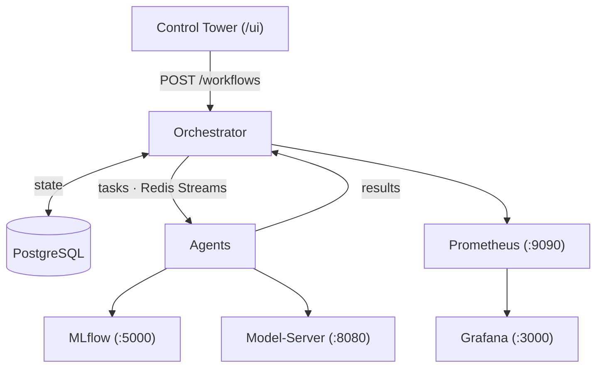

# Orchestraty

**An agent-driven AI operations platform — Kubernetes-style declarative control for the machine-learning lifecycle.**


You declare an **intent** — "train this model and serve it" — and Orchestraty compiles it into a task graph, dispatches each step to a specialized **agent**, tracks state, and continuously **reconciles** reality to your goal. It's the Kubernetes model applied to AI work: declarative desired-state, controllers (agents) that do the work, and a control loop that keeps everything converged — including **self-healing** when a model drifts.



---

## Contents

[Features](#features) · [Quick start](#quick-start) · [Usage](#usage) · [Capabilities](#capabilities) · [Templates](#workflow-templates) · [Dashboard](#dashboard) · [API](#api) · [Services](#services--ports) · [Configuration](#configuration) · [Testing](#testing) · [Project structure](#project-structure) · [Tech stack](#tech-stack) · [License](#license)

---

## Features

- **Declarative control plane** — submit an intent as a template or an explicit spec; the orchestrator compiles it into a validated task DAG (cycle-checked), schedules it, and reconciles workflow state.
- **Eight specialized agents** — training (MLflow), LLM completions, data extraction, infrastructure (Terraform), model deployment, drift/health monitoring, and automated recovery.
- **Redis Streams event bus** — agents are fully decoupled; tasks flow out on per-capability streams and results flow back, with consumer groups for at-least-once delivery and horizontal scaling.
- **Model training + registry** — the MLOps agent trains scikit-learn models, logs runs to **MLflow**, and registers versioned models.
- **Live model serving** — a **model-server** loads registered models and serves `/predict` with **stable + canary** slots and weighted traffic routing.
- **Self-healing loop** — the monitor agent scores drift (PSI) and health against thresholds; the recovery agent turns a breach into a corrective workflow (retrain or rollback) automatically.
- **Observability** — Prometheus metrics on the orchestrator and model-server, with a pre-provisioned **Grafana** dashboard.
- **Knowledge layer** — `/insights` (success rates, activity) and `/lineage/{model}` (which workflows trained/deployed a model), mined from an append-only event log.
- **Control Tower dashboard** — a single web UI to submit intents, watch workflows live, and inspect agents, capabilities, insights, and serving status.
- **One command to run it all** — `./run.ps1` (or `docker compose up`) brings up the entire 15-service stack.

---

## Quick start

**Prerequisites:** [Docker](https://www.docker.com/) with Compose (Docker Desktop on Windows/macOS). ~8 GB free disk for images. (Python 3.11 optional, only for running the unit tests locally.)

```bash
git clone https://github.com/samratrajsharma/Orchestraty.git
cd Orchestraty
```

**Windows (PowerShell):**

```powershell
./run.ps1              # builds + starts everything, opens the dashboard
./run.ps1 -Fresh       # wipe all volumes first (clean slate)
./run.ps1 -NoBrowser   # start without opening browser tabs
```

**macOS / Linux (or any OS):**

```bash
docker compose up --build
```

Then open the **Control Tower** at **http://localhost:8000/ui/**.

> First run pulls images and installs dependencies — it can take a few minutes. Stop everything with `docker compose down`.

---

## Usage

Everything is driven by submitting a **workflow** to the orchestrator (or by clicking *Run* in the dashboard).

**Run a built-in template** — go from nothing to a trained, deployed, serving model:

```bash
curl -X POST http://localhost:8000/workflows \
  -H "Content-Type: application/json" \
  -d '{"template": "train-and-serve"}'
```

**Submit a custom spec** — chain any capabilities into a DAG:

```bash
curl -X POST http://localhost:8000/workflows \
  -H "Content-Type: application/json" \
  -d '{
    "spec": {
      "name": "extract-then-train",
      "tasks": [
        {"key": "x", "capability": "data.transform",
         "payload": {"text": "iris dataset", "schema": [{"name":"ds","type":"regex","pattern":"iris|wine"}]}},
        {"key": "t", "capability": "mlops.train",
         "payload": {"dataset": "iris", "registered_model_name": "iris-classifier"},
         "depends_on": ["x"]}
      ]
    }
  }'
```

**Track it** (status, tasks, and each task's result):

```bash
curl http://localhost:8000/workflows/<workflow-id>
```

**Query a served model** (after a `train-and-serve` or a manual `/load`):

```bash
curl -X POST http://localhost:8080/predict \
  -H "Content-Type: application/json" \
  -d '{"inputs": [[5.1, 3.5, 1.4, 0.2]]}'
```

---

## Capabilities

Each capability is provided by one agent. Adding a new capability means adding one agent — the core never changes.

| Capability | Agent | What it does |
|---|---|---|
| `echo` | echo-agent | Reference agent (returns its input) |
| `mlops.train` | mlops-agent | Trains a scikit-learn model, logs to MLflow, registers a version |
| `llm.complete` | llmops-agent | Prompt versioning, cost-aware model routing, budget enforcement (mock provider by default) |
| `data.transform` | data-transform-agent | Extracts structured JSON from unstructured text via a schema |
| `infra.provision` | infra-agent | Generates Terraform IaC (plan mode by default) |
| `deploy.model` | deploy-agent | Deploys a model to the model-server with canary/blue-green rollout; emits K8s manifests |
| `monitor.check` | monitor-agent | Drift (PSI) + health/threshold detection |
| `recovery.heal` | recovery-agent | Maps a breach to a corrective workflow (retrain / rollback) |

## Workflow templates

Ready-made specs you can run by name (`{"template": "<name>"}`):

| Template | Flow |
|---|---|
| `echo-demo` | Two chained echo tasks |
| `summarize` | LLM summarization |
| `extract-contact` | Pull structured fields from text |
| `ml-pipeline` | `data.transform` → `mlops.train` → `llm.complete` |
| `provision-cluster` | Generate a GPU node-pool plan |
| `train-and-serve` | `mlops.train` → `deploy.model` (nothing → serving) |
| `heal-demo` | Trigger a recovery action from a breach |
| `monitor-and-heal` | `monitor.check` → `recovery.heal` |
| `train-and-deploy` | Legacy placeholder pipeline |

---

## Dashboard

The **Control Tower** (`http://localhost:8000/ui/`) is served by the orchestrator itself. It provides an intent bar (templates + custom spec), a live-refreshing workflows board with task drill-down, and panels for agents, capabilities, insights, and serving status. Links from the header:

| UI | URL |
|---|---|
| Control Tower | http://localhost:8000/ui/ |
| API docs (Swagger) | http://localhost:8000/docs |
| Grafana | http://localhost:3000 |
| Prometheus | http://localhost:9090 |
| MLflow | http://localhost:5000 |

---

## API

**Orchestrator** (`:8000`)

| Method | Path | Purpose |
|---|---|---|
| POST | `/workflows` | Submit an intent (`template` or `spec`) |
| GET | `/workflows` | List workflows |
| GET | `/workflows/{id}` | Workflow detail + tasks + results |
| GET | `/workflows/{id}/events` | Event trail |
| GET | `/workflows/{id}/stream` | Live status (Server-Sent Events) |
| POST | `/agents/register` | Agent registration |
| POST | `/agents/{id}/heartbeat` | Agent heartbeat |
| GET | `/agents` | List registered agents |
| GET | `/capabilities` | Capability catalog + templates |
| GET | `/insights` | Aggregate stats (success rate, counts) |
| GET | `/lineage/{model}` | Trace a model's train/deploy history |
| GET | `/metrics` | Prometheus metrics |
| GET | `/health`, `/readyz` | Liveness / readiness |

**Model-server** (`:8080`)

| Method | Path | Purpose |
|---|---|---|
| POST | `/load` | Load a model into `stable` or `canary` |
| POST | `/predict` | Serve a prediction (weighted stable/canary) |
| POST | `/promote` | Promote canary → stable |
| POST | `/rollback` | Drop the canary |
| GET | `/status` | Loaded models + canary weight |
| GET | `/metrics` | Prometheus metrics |

---

## Services & ports

`docker-compose.yml` defines **15 services**:

| Service | Port | Role |
|---|---|---|
| orchestrator | 8000 | Control plane, API, and dashboard (`/ui`) |
| postgres | 5432 | State store (workflows, tasks, agents, events) |
| redis | 6379 | Event bus (Redis Streams) |
| mlflow | 5000 | Experiment tracking + model registry |
| model-server | 8080 | Live inference (stable + canary) |
| prometheus | 9090 | Metrics scraping |
| grafana | 3000 | Metric dashboards |
| 8 agents | — | echo, mlops, llmops, data-transform, infra, deploy, monitor, recovery |

---

## Configuration

Every setting has a working default; override via environment variables in `docker-compose.yml` (or a `.env`).

| Variable | Default | Applies to |
|---|---|---|
| `ORCH_DATABASE_URL` | `postgresql+asyncpg://…@postgres:5432/orchestraty` | orchestrator |
| `ORCH_REDIS_URL` | `redis://redis:6379/0` | orchestrator + agents |
| `ORCH_LOG_LEVEL` | `INFO` | orchestrator |
| `MLFLOW_TRACKING_URI` | `http://mlflow:5000` | mlops-agent, model-server |
| `LLM_PROVIDER` | `mock` | llmops-agent |
| `LLM_BUDGET_USD` | `5.0` | llmops-agent |
| `OPENAI_API_KEY` / `ANTHROPIC_API_KEY` / `OLLAMA_URL` | — | llmops-agent (opt-in real providers) |
| `MODEL_SERVER_URL` | `http://model-server:8080` | deploy-agent |
| `TF_APPLY` | `false` | infra-agent (real `terraform apply` when `true`) |

---

## Testing

The unit tests are pure Python (no infrastructure needed):

```bash
pip install -r requirements-dev.txt
./run-tests.ps1        # Windows
./run-tests.sh         # macOS / Linux
# -> 56 tests across orchestrator, agents, and model-server
```

End-to-end smoke test against a running stack (drives every capability and asserts):

```bash
docker compose up --build      # in one terminal
python e2e/smoke.py            # in another
```

---

## Project structure

```
Orchestraty/
├── orchestrator/              # Control plane (FastAPI) + dashboard
│   ├── app/
│   │   ├── intent.py compiler.py            # intent → validated task DAG
│   │   ├── engine.py statemachine.py dag.py retry.py   # task engine (pure + DB)
│   │   ├── bus.py streams.py dispatcher.py results_consumer.py   # event bus + control loop
│   │   ├── registry.py reaper.py liveness.py           # agent registry
│   │   ├── models.py db.py enums.py schemas.py         # state store
│   │   ├── metrics.py insights.py                      # observability + knowledge
│   │   ├── routers/                                    # agents, workflows, capabilities, metrics, insights
│   │   └── static/index.html                           # Control Tower dashboard
│   └── tests/
├── agents/                    # Containerized workers
│   ├── sdk/                   # BaseAgent (register · heartbeat · consume · respond)
│   ├── echo_agent/  mlops_agent/  llmops_agent/  data_transform_agent/
│   ├── infra_agent/ deploy_agent/ monitor_agent/ recovery_agent/
│   └── tests/
├── model_server/             # Live inference (stable + canary)
├── infra/                    # mlflow/, prometheus/, grafana/ provisioning
├── e2e/smoke.py              # End-to-end smoke test
├── docs/                     # architecture.html, DEEP-DIVE.md
├── docker-compose.yml        # 15 services
├── run.ps1                   # One-command launcher
└── run-tests.ps1 · run-tests.sh
```

---

## Tech stack

FastAPI · SQLAlchemy (async) + PostgreSQL · Redis Streams · MLflow · scikit-learn · Prometheus · Grafana · Terraform (generation) · Docker Compose · pytest.

## Documentation

- **[docs/architecture.html](docs/architecture.html)** — the system blueprint (open in a browser).
- **[docs/DEEP-DIVE.md](docs/DEEP-DIVE.md)** — how every feature works internally, with two end-to-end traces.

## License

Released under the [MIT License](LICENSE).
