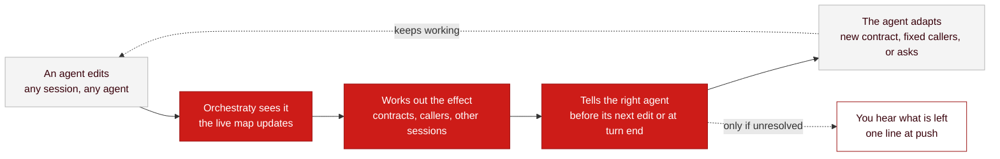
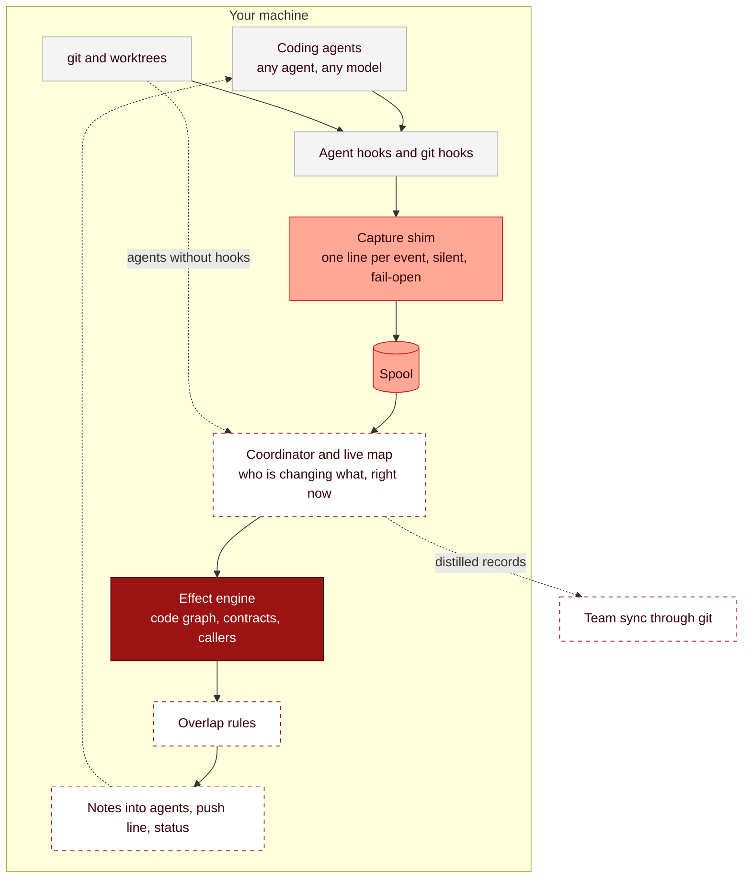

<div align="center">

# Orchestraty

**Run coding agents in parallel without them breaking each other's work.**

[](https://github.com/samratrajsharma/Orchestraty/actions/workflows/ci.yml)


[Overview](#overview) · [How it works](#how-it-works) · [Project status](#project-status) · [Repository layout](#repository-layout) · [Getting started](#getting-started) · [Development](#development) · [Privacy and security](#privacy-and-security)

</div>

---

## Overview

Many developers now run several coding-agent sessions on one repository at the same time, in separate worktrees or in the same folder. Each session works from a picture of the code that the other sessions are changing underneath it. One session changes a function's signature while another is busy writing new calls to the old one. The two branches touch different files, so git reports no conflict. The break shows up later, in CI or in production.

Orchestraty keeps parallel sessions aware of each other:

- **It watches what every session changes,** from the agent's own hooks or, for agents without hooks, from git.
- **It works out which changes matter to another session,** at the level of functions and contracts: a signature changed, a function deleted that another session still uses, the same function edited twice, callers left behind.
- **It tells the affected agent first,** before its next edit or before it finishes its turn, so the agent can adapt. You hear only about what the agents could not resolve.
- **It works with any agent,** at the deepest level that agent supports, and it never calls a model to decide anything. It behaves the same with hosted and self-hosted models.

A note to an agent looks like this:

```text
Another session changed payments.charge(): new required argument key.
billing/annual.py:88 still uses the old form. (worktree refunds, 1 min ago)
```

At `git push`, Orchestraty prints one line if something is still unresolved, and nothing otherwise.

Orchestraty does not start, run or display agents. It is not a cockpit and not an agent. It sits beside the agents and tools you already use.

> [!NOTE]
> Orchestraty is pre-release, and this page describes its design. Today the repository holds the effect engine, a scaffold for the main package, and the experiments that test the approach. There is no installer yet. See [Project status](#project-status).

## How it works

### The loop



Grey steps happen in your agents. Red steps are Orchestraty.

### Every kind of agent

Each agent connects at the deepest level it supports. No agent has to change, and plain git always works.

| Level | What the agent needs | What Orchestraty can do |
| --- | --- | --- |
| 0. Plain git | Nothing | Sees which files and functions changed in each worktree; warns the other sessions; prints the push line |
| 1. Tools (MCP) | MCP support | The agent can ask who is changing a file or function before it edits, and claim an area |
| 2. Hooks | A hook before and after a tool call, and at the end of a turn | Notes arrive automatically, before edits and at the end of a turn |
| 3. Rich interface | A Claude Code mod, or an editor extension | A pane of every session, a band for strong overlaps, holding an edit to ask you |

An agent is called supported only after its capture test with the real agent passes: its hooks record every event of real sessions, with none lost, without slowing it down. The table is generated from [`docs/agents.json`](docs/agents.json); the main package's [Agents](orchestraty/README.md#agents) section says what each agent can be told.

<!-- agents table: generated from docs/agents.json by scripts/agents_table.py; do not edit by hand -->
| Agent | Connects through | Status | Capture test with the real agent |
| --- | --- | --- | --- |
| Claude Code | Hooks (level 2) | Supported | Passed with Claude Code 2.1.283 on Windows, 27 September 2026 |
| Codex | Hooks (level 2) | Built; not yet tested with the real agent | Pending |
| Antigravity | Hooks (level 2) | Built; not yet tested with the real agent | Pending |
| Any other agent, editor or person | Plain git (level 0) | Basic support (git only) | None needed: its changes are read from git |
<!-- end of agents table -->

### How strong an overlap is

| Overlap | Strength | Who hears |
| --- | --- | --- |
| The same file changed in two sessions | Weak | Nobody is interrupted; it shows in the status view |
| The same function changed in both | Medium | Both agents, once |
| A breaking change in one session, and a use of that contract in the other | Strong | The using session, before its next affected edit |
| A breaking change whose callers no session has updated | Strong | The changing session, when it tries to finish; the push line if still left |
| Two sessions working in one folder (one worktree) | Medium | Both agents, once, with their next tool result |
| Two sessions that declared or claimed the same work | Medium | Both agents, once, with their next tool result; nothing is held back |

### Architecture

Everything runs on your machine. Hooks only append a line and exit, so they never slow an agent down. One process, started on demand, does the work and writes the notes in advance.



| In the diagram | Meaning |
| --- | --- |
| Dark red, solid | Built, and meant to last (`engine/`) |
| Light red, solid | Built as an experiment (`spikes/`), to be rebuilt properly if the experiment succeeds |
| White, dashed | Planned |
| Grey | Tools you already use |

### Design principles

- **Agents first, people last.** The affected agent hears first. A person hears only what the agents could not resolve, in one line.
- **Never slow the agent down.** Hooks only append and exit. The one hook that waits reads a note prepared in advance.
- **Every agent, at the level it supports.** Hooks, MCP, a small helper for homemade agents, or plain git.
- **Facts first, no model on the hot path.** Every note is deterministic and cites a file and line.
- **Precision over recall.** A wrong note costs more than a missed one. Every note says how sure it is and what it did not analyse.
- **Local-first.** For one developer, nothing leaves the machine. Teams share distilled records through git.
- **Standards, not new formats:** hook events in the shape most agents already use, MCP and AGENTS.md.
- **Never used to rate people.**

## Project status

Orchestraty is in its validation stage. Before the product is built out, a short series of experiments checks the approach:

1. **Capture.** Hooks record every session event on Windows, WSL2 and macOS without slowing the agent or losing events. Claude Code on Windows has passed; other agents and platforms are next.
2. **Awareness.** When an agent is told what another session changed, the combined work stops breaking.
3. **Frequency.** Parallel sessions on real repositories collide often enough to matter.
4. **Demand.** Developers really do run several sessions on one repository at once.

| Part | Where | State |
| --- | --- | --- |
| Effect engine | [`engine/`](engine/) | Built, and being hardened |
| Main package (`orch` command, coordinator, live map, notes) | [`orchestraty/`](orchestraty/) | Scaffold: the package installs and reports its version; the components are planned |
| Agent-setup scanner | [`spikes/scan/`](spikes/scan/) | Experiment |
| Capture shim, git-hook chaining and latency harness | [`spikes/capture/`](spikes/capture/) | Experiment |
| Session-to-commit linker, event counter and custom-ref probe | [`spikes/capture/`](spikes/capture/) | Experiment |
| Change-effects classifier | [`spikes/_shared/`](spikes/_shared/) | Experiment |
| Coordinator, overlap rules, notes, Claude Code mod, editor extension | | Planned |
| Team sync through git | | Planned |

Experiment code lives in `spikes/` and will be deleted when the experiments end ([ADR-0002](docs/decisions/0002-throwaway-spikes-live-in-spikes.md)). The coordination core is built as product code in `orchestraty/` from the start ([ADR-0003](docs/decisions/0003-coordination-core-is-product-code-from-the-start.md)).

## Repository layout

```text
.
├── orchestraty/            The main package (Python package orchestraty, command orch)
│   ├── orchestraty/        Package source: capture, coordinator, live map, rules, delivery, adapters
│   └── tests/              Package test suite
├── engine/                 The effect engine (Python package orch_engine)
│   ├── orch_engine/        Ingest, parsing, code graph, analyses
│   ├── tests/              Engine test suite
│   ├── sample_repo/        Test fixture
│   └── scripts/            Maintenance scripts
├── spikes/                 Throwaway experiments, not part of the product
│   ├── scan/               Read-only agent-setup scanner
│   ├── capture/            Capture shim, git-hook chaining, latency harness
│   └── _shared/            Code shared by the experiments
├── plugins/claude-code/    The Claude Code plugin: the hooks, the mod, the MCP server and a skill
├── editors/vscode/         The VS Code and Cursor extension: a status bar item and a panel
├── scripts/                The smoke test of the built wheel, the install-to-first-note timing, the plugin's build
├── docs/decisions/         Architecture decision records
├── pyproject.toml          The one distribution, orchestraty: both packages in one wheel
├── .claude-plugin/         The marketplace file that lists the Claude Code plugin
└── .github/workflows/      Continuous integration and releases
```

## Getting started

### Prerequisites

| Need | For |
| --- | --- |
| Python 3.10 or later | The main package and the engine |
| Python 3.9 or later | The experiments. The scanner must also run on older systems. |
| git | Everything |
| pytest 8 or 9 | The test suites. It is the only dependency. |

### Install

Orchestraty is one pure-Python package for every operating system, `orchestraty`: the `orch` command and the engine, with no dependencies. It is not on PyPI yet. Build the wheel, or take it from a draft release, and install it as a command of its own with pipx or uv:

```bash
python -m pip install build
python -m build                    # dist/: the sdist and orchestraty-<version>-py3-none-any.whl
pipx install dist/orchestraty-<version>-py3-none-any.whl
# or: uv tool install dist/orchestraty-<version>-py3-none-any.whl
orch init                          # in the repository the agents work on
orch doctor                        # checks what Orchestraty needs, with a fix for each problem
```

Once it is published, `pipx install orchestraty` and `uv tool install orchestraty` will do the same.

`orch uninstall` takes out everything Orchestraty added, puts back the settings files `orch init` backed up where nothing is lost, and asks before removing its state folder; then `pipx uninstall orchestraty` (or `uv tool uninstall orchestraty`) removes the command. To try it and tell us how it went, see the [guide for trying Orchestraty](orchestraty/docs/beta.md).

With Claude Code you can install Orchestraty's plugin as well, which holds the hooks instead of your settings file and brings the mod, the MCP server and a skill. The repository is its marketplace; in Claude Code:

```text
/plugin marketplace add samratrajsharma/Orchestraty
/plugin install orchestraty@orchestraty
```

Then `orch init` turns the plugin's hooks on and adds none to the settings file. The plugin is built and passes `claude plugin validate --strict`; it has not been installed in a real Claude Code session yet. See [the plugin](orchestraty/README.md#the-claude-code-plugin).

In VS Code and Cursor, the extension in [`editors/vscode`](editors/vscode/README.md) shows the sessions on the workspace's repository and their overlaps, whatever agents run them, in a status bar item and a panel. Install it from the `.vsix` CI builds. It is built and unit-tested; it has not been tried in VS Code or Cursor yet.

### Run the tests

Windows (PowerShell):

```powershell
python -m pip install "pytest>=8,<10"
cd engine;      python -m pytest; cd ..
cd orchestraty; python -m pytest; cd ..
cd spikes;      python -m pytest; cd ..
```

macOS, Linux and WSL2:

```bash
python3 -m venv .venv
. .venv/bin/activate
python -m pip install "pytest>=8,<10"
(cd engine && python -m pytest)
(cd orchestraty && python -m pytest)
(cd spikes && python -m pytest)
```

On Debian and Ubuntu, including the default WSL2 distribution, `venv` needs the `python3-venv` package first (`sudo apt install python3-venv`). To leave no bytecode caches behind, set `PYTHONDONTWRITEBYTECODE=1` first.

### Try what exists

```bash
pip install -e .                   # both packages, from where they are, for development
orch --version
orch doctor

# Structural regression check of the current branch against main
python -m orch_engine.check --repo . --base main

# Read-only graph tools for coding agents, over MCP (a development tool: the mcp package is not a dependency)
pip install "mcp>=1.2,<2"
python -m orch_engine.mcp_server --repo .
```

`pip install -e ".[treesitter]"` adds the optional extra that lets the engine parse more languages: Go, Java, Rust, C#, Ruby, PHP, C and C++. It isn't needed for the tests. Run `orch` rather than `python -m orchestraty` from the repository's top folder: there, Python finds the folder `orchestraty/` before the package.

Engine settings (`ORCH_DATA_DIR`, `ORCH_USE_CACHE`) and modules are described in [`engine/README.md`](engine/README.md).

## Development

### Workflow

Every change goes through a short-lived branch, and reaches `main` only after CI passes on that branch.

```bash
git switch -c feat/short-name              # 1. branch from main
git add <paths>                            # 2. commit in small, reviewable steps
git commit -m "feat(scope): what changed"
git push -u origin feat/short-name         # 3. CI runs on the branch

# 4. once CI is green
git switch main
git merge --ff-only feat/short-name
git push
git branch -d feat/short-name              # 5. clean up
git push origin --delete feat/short-name
```

Commit messages follow [Conventional Commits](https://www.conventionalcommits.org/). History stays linear: branches are merged fast-forward only.

### Continuous integration

Orchestraty is pure Python and standard library only, so there is one codebase for every operating system and one wheel for all of them. CI checks that the same code runs everywhere.

| Run | Platforms and Python | When |
| --- | --- | --- |
| Quick | Windows 3.12; Linux 3.12 | Every push and pull request |
| Package and smoke | The sdist and the wheel built on Linux; the smoke test of that wheel on Windows and Linux 3.12 | Every push and pull request |
| Editor extension | Its tests on Windows and Linux with Node 22; the `.vsix` packaged on Linux and kept as the `vsix` artifact | Every push and pull request |
| Full | Adds Linux 3.9, 3.10 and 3.11, and macOS 3.12, and the smoke test on macOS | Weekly on Mondays, on manual runs, and on release tags (`v*`) |

The quick and full runs run the main package, engine and experiment tests; Python 3.9 runs only the experiments, because the scanner must work on older systems. The smoke test (`scripts/smoke.py`) installs the built wheel in a clean virtual environment and runs `orch --version`, `orch init --print`, two scripted sessions through the installed hook script that reach a note, and `orch doctor`, with no real agent and no network. Two more jobs test the TypeScript helper and the TypeScript contracts with Node. The editor extension's job publishes nothing. Every job fails if it leaves any file behind. A branch is merged once CI is green on it.

### Releases

`.github/workflows/release.yml` runs on a tag `v<version>`, the version kept in `orchestraty/orchestraty/__init__.py` (the one place it is kept). It builds the sdist and the wheel, runs the smoke test on Windows, macOS and Linux, and attaches the files to a draft GitHub release, which stays a draft until it is published by hand. Publishing to PyPI is a job of its own, off until the legal check: it runs only when the workflow is started by hand on the tag with `publish-to-pypi` ticked, and uses trusted publishing (the `pypi` environment), so no token or secret is kept anywhere.

`scripts/first_note_timing.py` times the plan's pass check, install to first note on a 10,000-file repository: in a temporary folder it installs the built wheel in a fresh virtual environment, generates (or clones, with `--repo`) the repository, runs `orch init --yes` with its own agent config, plays the two scripted sessions and prints each step's time.

### Conventions

- **Main package and engine:** Python 3.10 or later, and standard library only in the core. Optional extras are imported lazily, so a missing extra turns off one feature instead of breaking import.
- **Experiments:** Python 3.9 or later, standard library only, and a test for every safety property.
- **Import direction:** the main package may import the engine; neither imports from `spikes/`.
- **Files:** LF line endings (enforced by `.gitattributes`), UTF-8 without BOM.
- **Tests leave nothing behind:** no `__pycache__`, no `.pytest_cache`, no output files.
- **Data:** fixtures are synthetic. Secrets, real transcripts, scan results and other data are never committed.
- **Decisions:** anything that shapes the design is recorded as an ADR in [`docs/decisions/`](docs/decisions/), starting from the [template](docs/decisions/template.md).

### Decision records

| ADR | Decision |
| --- | --- |
| [0001](docs/decisions/0001-effect-engine-starts-from-earlier-core.md) | The effect engine starts from the core of an earlier product. |
| [0002](docs/decisions/0002-throwaway-spikes-live-in-spikes.md) | Throwaway experiment code lives in `spikes/`. |
| [0003](docs/decisions/0003-coordination-core-is-product-code-from-the-start.md) | The coordination core is product code from the start, in `orchestraty/`. |

## Privacy and security

- **Nothing leaves your machine by default.** Raw prompts and transcripts stay where the agent keeps them. Teams share only distilled records (files, functions and contract changes) under a policy committed to their own repository.
- **Notes are facts, not text from other sessions.** Every note is built from a template filled with structured fields such as a function name, a file and a line, so one session cannot inject instructions into another.
- **No model calls.** Orchestraty never sends your code to a model to decide anything.
- **The scanner reads names and counts, never content.** It never opens session, transcript or history files. See [`spikes/scan/PRIVACY.md`](spikes/scan/PRIVACY.md).
- **Capture never disturbs the agent.** Its hooks print nothing and never block or fail the agent.
- **The engine checks what it loads.** Its cache is signed, so a tampered cache is not trusted.
- **No telemetry.** Nothing about how you use it is sent anywhere.

Please report security issues privately to the maintainers, not in a public issue.

## Licence

No licence has been chosen yet. Until one is, all rights are reserved.
