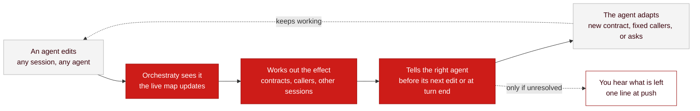

<div align="center">

# Orchestraty

**Run coding agents in parallel without them breaking each other's work.**

[](https://github.com/samratrajsharma/Orchestraty/actions/workflows/ci.yml)


[What it is](#what-it-is) · [Install](#install) · [Your first note](#your-first-note) · [Integration levels](#integration-levels) · [Agents](#agents) · [Privacy](#privacy) · [Development](#development)

</div>

---

## What it is

Orchestraty keeps several coding-agent sessions on one repository aware of each other: it sees what each session changes and works out, at the level of functions and their contracts, which changes break another session's work. It tells the affected agent before it builds on the old form, so the agents adapt while they work, and you hear only what they leave unresolved.

A note to an agent looks like this (a real one, as the hook hands it to Claude Code before it edits `c.py`):

```text
Orchestraty: another Claude Code session (worktree refunds, branch feat-refunds) changed the contract
of charge in a.py: parameter currency removed. The change is in that worktree, so your copy does not
show it yet; both meet when merged. c.py uses it: use (line 5). Check these uses before you change
this file: leaving that argument out works with both forms, where it was optional; otherwise agree
with that session if the old form must stay. Static calls only; dynamic calls are not analysed.
```

Every note is filled in from a template with facts from git and the code; no model is ever called, and nothing another session wrote reaches it. Orchestraty does not start, run or display agents: it sits beside the agents and tools you already use. What it will and will not do is set out in [the rules](docs/rules.md).

> [!NOTE]
> Orchestraty is pre-release. Everything this page describes exists and has automated tests, which CI runs on Windows and Linux (and macOS weekly); where something has not yet been tried with a real agent or editor, the page says so. Claude Code's capture test with the real agent has passed; a full run of two real agent sessions reaching a note, and its timings, are still to do. Contracts are compared for Python, and for TypeScript only when you turn it on (`orch ts on`), heuristically.

## Install

You need Python 3.10 or later and git. Orchestraty is one pure-Python package with no dependencies, the same for every operating system. It is not on PyPI yet: build the wheel, or take it from a draft release, and install it as a command of its own with pipx or uv.

```bash
python -m pip install build
python -m build                    # dist/: the sdist and orchestraty-<version>-py3-none-any.whl
pipx install dist/orchestraty-<version>-py3-none-any.whl
# or: uv tool install dist/orchestraty-<version>-py3-none-any.whl
```

To take it all out again, `orch uninstall` removes everything Orchestraty added, puts back the settings files it backed up where nothing is lost, and asks before removing its state folder; then `pipx uninstall orchestraty` (or `uv tool uninstall orchestraty`) removes the command.

## Your first note

With Claude Code:

1. **Install the hooks,** in the repository your agents work on:

   ```bash
   cd path/to/your/repository
   orch init          # shows what it will change and asks first
   orch doctor        # checks everything Orchestraty needs, with a fix for each problem
   ```

   `orch init` adds hook entries to Claude Code's user settings (backing the file up first), watches this repository, and offers the push line: a git pre-push hook chained in front of the repository's own. For Codex or Antigravity, add `orch init --agent codex` or `orch init --agent antigravity`.
2. **Give each session its own worktree:**

   ```bash
   git worktree add ../refunds -b feat-refunds
   git worktree add ../billing -b feat-billing
   ```

3. **Start a session in each,** `claude` in `../refunds` and in `../billing`. Nothing else needs starting: the first hook starts Orchestraty's background process, which indexes the repository once (`orch doctor` says how long that takes here) and exits after ten minutes with nothing to do.
4. **Change a function in one session.** In `refunds`, ask the agent to change a Python function's signature, say to remove a parameter of `charge()`.
5. **Use it in the other.** In `billing`, ask for work in a file that calls `charge()` the old way. Before its agent first edits that file, the hook hands it a note like the one above, and it adapts, or asks you.
6. **See it yourself:** `orch status` shows the two sessions, what each changed and the overlap between them. If `refunds` finishes its turn with callers still on the old form, its agent hears so then; at `git push`, the push line says so in one line, and never blocks the push.

The CI smoke test plays this scenario on every push with two scripted sessions through the installed hook script. [The guide for trying Orchestraty](orchestraty/docs/beta.md) says more about what you will see, and how to label findings and report a missed note.

## Integration levels

Each agent connects at the deepest level it supports. No agent has to change, and plain git always works.

| Level | For | What Orchestraty does | Where it stands |
| --- | --- | --- | --- |
| 0. Plain git | Any agent, editor or person; cloud agents' branches, with `orch remote on` | Follows what changed in each worktree, tells the sessions with hooks, prints the push line | Tested in CI |
| 1. MCP | Agents that support MCP | The agent can ask who is changing a file or function before it edits, say what it is about to change, and claim it: `orch mcp` | Built; not yet tested with the real agents |
| 2. Hooks | Agents with hooks, and agents you build yourself with the two-call helper | Notes arrive without asking: before an edit, with the next step, at the end of a turn | See [Agents](#agents) |
| 3. Rich interface | Claude Code (the mod and the plugin); VS Code and Cursor (the extension) | A status line, a band for strong overlaps and a pane of every session; a status bar item and a panel | Built and unit-tested; the plugin not yet installed in a real Claude Code session, the extension not yet tried in VS Code or Cursor |

## Agents

An agent is called supported only after its capture test with the real agent passes: its hooks record every event of real sessions, with none lost, without slowing it down. The table is generated from [`docs/agents.json`](docs/agents.json); the main package's [Agents](orchestraty/README.md#agents) section says what each agent can be told.

<!-- agents table: generated from docs/agents.json by scripts/agents_table.py; do not edit by hand -->
| Agent | Connects through | Status | Capture test with the real agent |
| --- | --- | --- | --- |
| Claude Code | Hooks (level 2) | Supported | Passed with Claude Code 2.1.283 on Windows, 27 September 2026 |
| Codex | Hooks (level 2) | Built; not yet tested with the real agent | Pending |
| Antigravity | Hooks (level 2) | Built; not yet tested with the real agent | Pending |
| Any other agent, editor or person | Plain git (level 0) | Basic support (git only) | None needed: its changes are read from git |
<!-- end of agents table -->

### How strong an overlap is

| Overlap | Strength | Who hears |
| --- | --- | --- |
| The same file changed in two sessions | Weak | Nobody is interrupted; it shows in `orch status` |
| The same function changed in both | Medium | Both agents, once |
| A breaking change in one session, and a use of that contract in a file the other is changing | Strong | The using session, before its next edit of that file |
| A function removed in one session and still used in the other | Strong | The using session, before its next edit of that file |
| The same HTTP route changed in both | Strong | Both agents, with their next step |
| A breaking change whose callers no session has updated | Strong | The changing session, at the end of its turn; the push line if still left |
| Two sessions working in one folder (one worktree) | Medium | Both agents, once, with their next step |
| Two sessions that declared or claimed the same work | Medium | Both agents, once, with their next step |

Each session hears about a finding once, and a weak overlap never interrupts anyone: [the silence rule](docs/rules.md#the-silence-rule).

## How it works



Everything runs on your machine. An agent's hook runs a small script that appends one line to a file and exits; the one thing it waits for is a note already written for it. One background process per user, started by the first hook that needs it, reads those lines and git, keeps a live map of what each session has changed since its base commit, runs the [contract engine](engine/) and the overlap rules, and writes each note in advance for the session that must hear it. `orch status`, the Claude Code mod, the editor extension and the MCP tools all show what that process found; none of them detects anything itself. The main package's [README](orchestraty/README.md) describes every command.

## Privacy

- **Nothing leaves your machine.** There is no account and no telemetry. The only network access is opt-in: `orch remote on` fetches cloud agents' branches from your repository's own remote.
- **The hooks record names, not content:** event names, session ids, folders and the paths of edited files. Never prompts, file contents, commands or tool output; transcripts are never opened.
- **Notes are facts, not text from other sessions,** so one session cannot give another instructions through a note.
- **No model calls.** Orchestraty never sends your code to a model to decide anything.
- **What you share, you export yourself:** `orch stats --summary` and `orch feedback` print everything first, save it only where you say, and send nothing.
- **It asks before it writes inside a repository,** and backs up every settings file it changes.

What Orchestraty reads and writes, and how to report a security problem privately, are in [SECURITY.md](SECURITY.md).

## Development

[CONTRIBUTING.md](CONTRIBUTING.md) covers setting up, the rules for code and tests, adding an agent adapter, and the commit style. What changed is in [CHANGELOG.md](CHANGELOG.md).

```text
.
├── orchestraty/            The main package: the orch command, hooks, coordinator, live map, rules, notes, adapters
├── engine/                 The contract engine (orch_engine): parsing, code graph, contracts
├── plugins/claude-code/    The Claude Code plugin: the hooks, the mod, the MCP server and a skill
├── editors/vscode/         The VS Code and Cursor extension
├── helpers/typescript/     The two-call helper for homemade agents, in TypeScript
├── examples/               A homemade agent that uses the Python helper
├── scripts/                The smoke test of the built wheel, install-to-first-note timing, the plugin's build, the agents table
├── spikes/                 Throwaway experiments from the validation stage, not part of the product
├── docs/                   The rules, the agents' test results, and the decision records
└── pyproject.toml          One distribution, orchestraty: both packages in one wheel
```

### Run the tests

```bash
pip install -e .                   # both packages, from where they are
python -m pip install "pytest>=8,<10"
(cd orchestraty && python -m pytest)
(cd engine && python -m pytest -p no:cacheprovider)
(cd spikes && python -m pytest)
```

On Windows, run the same from PowerShell, one folder at a time. Set `PYTHONDONTWRITEBYTECODE=1` to leave no bytecode caches behind. From the repository's top folder, run `orch` rather than `python -m orchestraty`: there, Python finds the folder `orchestraty/` before the package. `pip install -e ".[treesitter]"` adds the optional extra that lets the engine parse more languages (Go, Java, Rust, C#, Ruby, PHP, C and C++); the tests don't need it.

### Continuous integration

| Run | Platforms and Python | When |
| --- | --- | --- |
| Quick | Windows 3.12; Linux 3.12 | Every push and pull request |
| Package and smoke | The sdist and the wheel built on Linux; the smoke test of that wheel on Windows and Linux 3.12 | Every push and pull request |
| Node | The TypeScript helper, the TypeScript contracts and the editor extension (its `.vsix` kept as an artifact), on Windows and Linux | Every push and pull request |
| Full | Adds Linux 3.9, 3.10 and 3.11, and macOS 3.12, and the smoke test on macOS | Weekly on Mondays, on manual runs, and on release tags (`v*`) |

The smoke test (`scripts/smoke.py`) installs the built wheel in a clean virtual environment and runs `orch --version`, `orch init --print`, two scripted sessions through the installed hook script that reach a note, and `orch doctor`, with no real agent and no network. Python 3.9 runs only the experiments. Every job fails if its tests leave any file behind.

### Releases

`.github/workflows/release.yml` runs on a tag `v<version>`, the version kept in `orchestraty/orchestraty/__init__.py`. It builds the sdist and the wheel, runs the smoke test on Windows, macOS and Linux, and attaches the files to a draft GitHub release, which stays a draft until it is published by hand. Publishing to PyPI is a job of its own, off until it is turned on: it runs only when the workflow is started by hand on the tag with `publish-to-pypi` ticked, and uses trusted publishing, so no token is kept anywhere. `scripts/first_note_timing.py` times install to first note on a 10,000-file repository.

### Decision records

| ADR | Decision |
| --- | --- |
| [0001](docs/decisions/0001-effect-engine-starts-from-earlier-core.md) | The effect engine starts from the core of an earlier product. |
| [0002](docs/decisions/0002-throwaway-spikes-live-in-spikes.md) | Throwaway experiment code lives in `spikes/`. |
| [0003](docs/decisions/0003-coordination-core-is-product-code-from-the-start.md) | The coordination core is product code from the start, in `orchestraty/`. |

## Licence

No licence has been chosen yet. Until one is, all rights are reserved.
