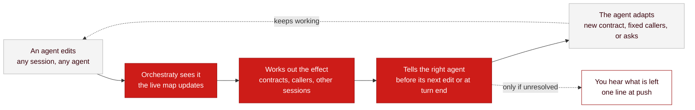

<div align="center">

# Orchestraty

**Run coding agents in parallel without them breaking each other's work.**

[](https://github.com/samratrajsharma/Orchestraty/actions/workflows/ci.yml)


[](https://github.com/samratrajsharma/Orchestraty/blob/main/LICENSE)

[What it does](#what-it-does) · [Quick start](#quick-start) · [What you'll see](#what-youll-see) · [Try it](#try-it-in-five-minutes) · [What's in Phase 1](#whats-in-phase-1) · [Feedback](#tell-us-how-it-goes) · [Privacy](#privacy)

</div>

---

> [!NOTE]
> **This is Phase 1, in early access.** Everything on this page is built, with automated tests on Windows, macOS and Linux, and Claude Code is also tested with the real agent. Try it on your own projects and tell us what you find. We're working on the next phases and will open them soon.

## What it does

When you run several coding agents on one repository, each in its own worktree, one of them can change something another relies on: a function's arguments, a route, a helper it removes. Each branch passes its own tests, and the break shows up only when you merge.

Orchestraty watches what each session changes. When a change affects another session's work, it tells that agent, in a short note, before it builds on the old form. The agents adapt while they work, and you hear only what they leave unresolved.



A note, as the agent about to edit `shop/checkout.py` receives it:

```text
Orchestraty: another Claude Code session (worktree refunds, branch feat-refunds) changed the contract
of charge in shop/payments.py: parameter currency can no longer be passed by position. The change is
in that worktree, so your copy does not show it yet; both meet when merged. shop/checkout.py uses it:
checkout (line 11). Check these uses before you change this file: passing the arguments by name works
with both forms; otherwise agree with that session if the old form must stay. Static calls only;
dynamic calls are not analysed.
```

Every note is filled in from a template with facts from git and the code. Orchestraty never calls an AI model, never runs your agents for you, and nothing leaves your machine.

**Who it's for.** Phase 1 is for developers, and anyone building software with coding agents, who run two or more agent sessions on the same repository at once. It works best today with **Claude Code**, in the terminal or the desktop app, on **Python** code. Codex and Antigravity can be tried too, but are less tested.

## Quick start

You need Python 3.10 or later and a recent Claude Code (`claude update`; the status line and pane need 2.1.287 or later). Projects in git need git 2.38 or later; a project folder without git needs nothing more.

**1. Install.**

```bash
python -m pip install orchestraty
```

`pipx install orchestraty` or `uv tool install orchestraty` work too. If your terminal can't find `orch` afterwards, type `python -m orchestraty` in its place. To try the newest work on `main` before it is released, install from the repository instead: `python -m pip install "git+https://github.com/samratrajsharma/Orchestraty.git"`.

**2. Switch it on, once for the whole computer**, from a terminal (not from inside an agent session), in any folder:

```bash
orch init       # shows what it will change, and asks first
orch doctor     # checks everything, with a fix for each problem
```

`orch init` adds Orchestraty's hooks, the status line and the pane to Claude Code's settings (backing the file up first), and offers the same for Codex and Antigravity when they are on the computer. It asks once whether to follow every project your agents work in, from then on: a git repository, or a folder without git, which Orchestraty follows through its own snapshots in its state folder, writing nothing into the project. Nothing needs running per project; `orch unwatch` in a project leaves it out, and `orch config track off` goes back to following only the projects you `orch watch`. Run in a git repository, it also offers the push line there: a git hook that adds one line to `git push` when callers of a function you changed are still on the old form.

**3. See it before you rely on it.**

```bash
orch ui --demo  # plays the whole loop with two pretend sessions, in a sandbox, in your browser
```

**4. Work as usual.** Restart any Claude Code sessions that were already open, and give each session its own worktree; the Claude desktop app does that for you. Nothing else needs starting: Orchestraty starts in the background with the first session, and stops when it is idle.

## What you'll see

Mostly nothing. Notes go to the agents, not to you, and only when one session's change affects another's work.

| Where | What |
| --- | --- |
| In an agent's session | A note: before it edits a file, with its next step, or at the end of its turn |
| `orch status`, or `orch ui` in your browser | Every project, its live sessions, what each has changed, and where they overlap. `orch ui` always opens at http://127.0.0.1:47392, and running it again from any folder opens the one already running |
| At `git push` | One line when callers of a changed function are still on the old form. It never blocks the push |
| Claude Code 2.1.287 or later | A status line, a highlighted band when an overlap is strong, and `/orch` to open a pane of every session |

## Try it in five minutes

1. Make two worktrees of a Python repository:

   ```bash
   git worktree add ../one -b try-one
   git worktree add ../two -b try-two
   ```

2. Start a Claude Code session in each.
3. In `one`, ask the agent to change a function's signature, for example to make one of its parameters keyword-only.
4. In `two`, ask for work in a file that calls that function the old way. Before the agent edits that file, it gets a note and adapts.
5. Run `orch status` to see both sessions and the overlap. If `one` ends its turn with callers still on the old form, its agent hears which. To see the push line without pushing anything, run `git push --dry-run origin try-one` in `one`.

[The guide for testers](https://github.com/samratrajsharma/Orchestraty/blob/main/orchestraty/docs/beta.md) has a step for every feature.

## What it notices

| Overlap | Strength | Who hears |
| --- | --- | --- |
| The same file changed in two sessions | Weak | Nobody is interrupted; it shows in `orch status` |
| The same function changed in both | Medium | Both agents, once |
| A breaking change in one session (to a function's parameters, say), and a use of it in a file the other is changing | Strong | The session using it, before its next edit of that file |
| A function removed in one session and still used in the other | Strong | The session using it, before its next edit of that file |
| The same HTTP route changed in both (FastAPI, Flask, Django) | Strong | Both agents, with their next step |
| A breaking change whose callers no session has updated | Strong | The changing session, at the end of its turn; you, in the push line |
| Two sessions working in one folder instead of separate worktrees | Medium | Both agents, once: use a worktree |
| Two sessions that claimed the same file or function, with `orch claim` or by an agent asking through MCP | Medium | Both agents, once, with their next step |

Each session hears about a finding once, and a weak overlap never interrupts anyone: see [the silence rule](https://github.com/samratrajsharma/Orchestraty/blob/main/docs/rules.md#the-silence-rule).

## What's in Phase 1

| Command | What it does |
| --- | --- |
| `orch init`, `orch doctor` | Switch it on, and check it |
| `orch status`, `orch ui` | The sessions and their overlaps, in the terminal or in your browser (this computer only) |
| `orch claim`, `orch claims`, `orch release` | Reserve a file, folder or function for one session; the others hear before they edit it |
| `orch merge-order` | Which branch to merge first, when one uses another's change |
| `orch handoff`, `orch resume` | Package a session's work, and start an agent on it in a new worktree |
| `orch together on` | Run your tests on two overlapping sessions' work merged, and tell both if it fails together (opt-in) |
| `orch ts on` | TypeScript contracts (opt-in; its notes say they are heuristic) |
| `orch mcp --config claude` | Let agents ask before they edit: who else is changing this file? |
| `orch remote on` | Include cloud agents' branches (opt-in; the one use of the network) |
| `orch config steer on`, `orch config wake on` | Stop an edit on a strong note, or wake an idle session with it (opt-in) |
| `orch findings`, `orch label`, `orch missed`, `orch stats`, `orch feedback` | Tell us how it went |
| `orch restore`, `orch uninstall` | Take the hooks out, or everything |

Every command is described in [the main package's README](https://github.com/samratrajsharma/Orchestraty/blob/main/orchestraty/README.md).

## Agents

An agent is called supported only once its hooks have been tested with the real agent. Claude Code is, and two real Claude Code sessions reach their notes end to end. Any other agent or editor is still seen through git: its changes count, but it gets no notes.

<!-- agents table: generated from docs/agents.json by scripts/agents_table.py; do not edit by hand -->
| Agent | Connects through | Status | Capture test with the real agent |
| --- | --- | --- | --- |
| Claude Code | Hooks (level 2) | Supported | Passed with Claude Code 2.1.283 on Windows, 27 September 2026 |
| Codex | Hooks (level 2) | Built; not yet tested with the real agent | Pending |
| Antigravity | Hooks (level 2) | Built; not yet tested with the real agent | Pending |
| Any other agent, editor or person | Plain git (level 0) | Basic support (git only) | None needed: its changes are read from git |
<!-- end of agents table -->

Level 2 means the agent's own hooks hand it its notes; level 0, that only its changes in git are seen. What each agent can be told is in [the main package's README](https://github.com/samratrajsharma/Orchestraty/blob/main/orchestraty/README.md#agents).

## Tell us how it goes

Your verdicts decide what gets built next.

- **Two minutes a day:** `orch findings`, then `orch label <number> real` (or `harmless`, or `false`) for anything new. When something should have been noted and wasn't: `orch missed "what happened"`.
- **Once a week:** `orch feedback` shows the counts plus your comment, and saves them to a file where you say. It sends nothing: attach the file to an issue here, or send it to whoever invited you.
- **Anything else,** a bug, a confusing note or an idea: open an issue on this repository.
- **A strong note that was wrong** is the most serious kind of bug: please tell us the same day. `orch findings` shows how strong each finding was.

## Privacy

- **Nothing leaves your machine.** There is no account and no telemetry. The only network use is opt-in: `orch remote on` fetches cloud agents' branches from your repository's own remote.
- **The hooks record names, not content:** event names, session ids, folders and the paths of edited files. Never prompts, file contents, commands or tool output.
- **No AI model, and no text from other sessions,** in any note: one session cannot give another instructions through Orchestraty.
- **It asks before it changes anything,** and backs up every settings file first.

What Orchestraty reads and writes, and how to report a security problem privately, are in [SECURITY.md](https://github.com/samratrajsharma/Orchestraty/blob/main/SECURITY.md).

## Limits

- Python is analysed in full; TypeScript only when you turn it on, and heuristically.
- Static calls only: dynamic calls aren't seen, and a note about a changed function says so.
- The engine reads at most 20,000 files of a repository; `orch doctor` tells you when yours has more.
- An agent hears at its next step; an idle one only when it next acts, unless wake is on.
- Codex and Antigravity are built, but less tested than Claude Code.
- No note means Orchestraty found nothing, not that nothing is wrong.

What Orchestraty will and will not do is set out in [the rules](https://github.com/samratrajsharma/Orchestraty/blob/main/docs/rules.md).

## Upgrade, or take it out

To take a newer release:

```bash
python -m pip install --upgrade orchestraty    # or: pipx upgrade orchestraty, uv tool upgrade orchestraty
orch init                   # puts the new hook script in place, and restarts the background process
```

From 0.1.4 on, the background process also restarts by itself within a minute of an upgrade, and `orch ui` says when the dashboard you have open is an earlier version.

To take it all out:

```bash
orch uninstall                          # shows what it will take out, then asks
python -m pip uninstall orchestraty
```

`orch uninstall` takes out everything Orchestraty added, puts back the settings files it backed up where nothing is lost, and asks before deleting its record.

## Contributing

[CONTRIBUTING.md](https://github.com/samratrajsharma/Orchestraty/blob/main/CONTRIBUTING.md) covers setting up, the tests, CI and releases. [CHANGELOG.md](https://github.com/samratrajsharma/Orchestraty/blob/main/CHANGELOG.md) says what changed.

## Licence

Orchestraty is licensed under the [Apache License 2.0](https://github.com/samratrajsharma/Orchestraty/blob/main/LICENSE).
